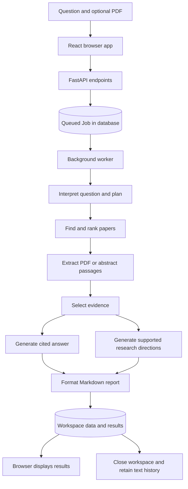
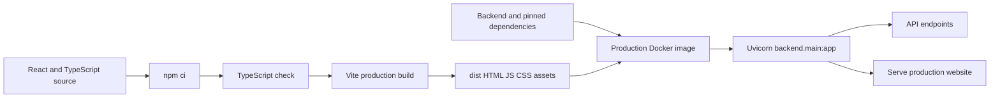

# ResearchOS: complete flow, folder guide, and speed build plan

Checked against the current repository on 15 October 2026. This is the single teaching guide for understanding the app and planning its speed improvements. Sections 1-8 describe existing behavior. Section 9 proposes work to build; writing this guide does not implement those optimizations.

## 1. What you are building

ResearchOS takes a research question, finds academic sources or uses an uploaded PDF, extracts passages, and asks a language model to produce a cited answer and possible research directions.

For your question:

> why lls mutli agent system consumes more compute

The intended meaning is:

> Why do LLM multi-agent systems use more computation than a single agent?

Search must preserve the subject, multi-agent LLM systems, and the intent, compute cost. A paper mentioning agents alone is not necessarily relevant. Appropriate search concepts include computational overhead, repeated inference, token usage and communication overhead. These are illustrative concepts, not guaranteed planner output.

| Output | Meaning |
| --- | --- |
| Research answer | A direct explanation supported by selected source passages. |
| Supporting findings | Specific points connected to their source passages. |
| Research directions | Evidence-supported questions or author-stated limitations to investigate. |

A direction is not proof of worldwide novelty. Natural language research questions are accepted across subjects, but success still requires relevant readable evidence and a working model provider.

## 2. The architecture



Answer and gap generation are logically independent, but **currently execute sequentially inside `analysis_node()`**. The diagram does not imply concurrency is already implemented.

| Technology | Its job |
| --- | --- |
| React, TypeScript, CSS | Screens, forms, state and user interactions. |
| Vite | Local frontend server and production website build. |
| FastAPI, Uvicorn | Python HTTP API and server. |
| SQLAlchemy | Python database access and table mappings. |
| PostgreSQL/Supabase or SQLite | Actual database storage. Supabase hosts PostgreSQL; SQLAlchemy does not replace it. |
| LangGraph | Runs a fixed sequence of research steps. |
| HTTPX | Makes network requests to search and AI services. |
| pypdf | Extracts text from readable PDFs. |
| Configured LLM | Interprets the question and generates structured text from evidence. |
| Redis, optional | Reuses academic-search metadata for a limited time. |
| pgvector, optional | Supports vector similarity for follow-up retrieval. |

Using LangGraph does not mean this application has multiple autonomous agents debating. It currently executes a predefined research workflow. Asking about multi-agent systems does not turn this app into one.

## 3. Every folder and important file

Paths below are relative to the repository root, `F:\Raglearn`.

```text
Raglearn/
  src/                         Browser application
    App.tsx                    Screens, state, actions and progress polling
    ResearchGaps.tsx           Source limitations and concrete gap-study cards
    api.ts                     Shared HTTP helper and API error handling
    types.ts                   TypeScript shapes for backend responses
    styles.css                 Layout, colors and responsive styles
    main.tsx                   Mount React and load styles/fonts
    assets/                    Bundled favicon and background images
  backend/                     Python application
    main.py                    API, authentication, worker and startup
    db.py                      Database engine, sessions and table definitions
    discovery.py               AI planning, OpenAlex adapter and ranking
    research.py                Workflow, arXiv, PDF parsing, retrieval, synthesis
    history.py                 Archive sessions and delete temporary research data
    cache.py                   Optional Redis metadata cache
    storage.py                 Read/delete legacy stored PDFs only
    requirements.txt           Allowed Python dependency version ranges
    requirements.lock.txt      Pinned dependencies used by Docker
    __init__.py                Marks backend as a Python package
  docs/                        Explanations and setup guides
    researchos-rag-explained.md This guide
    setup-and-reference.md     Existing setup/reference material
    supabase-setup.md          Existing Supabase setup material
  artwork/source/              Original artwork used to create app images
  tests/                       Local automated checks; ignored by Git
  public/                      Local unused artwork; ignored and not served
  data/                        Local database and QA scratch data
  dist/                        Generated production website
  node_modules/                Installed JavaScript dependencies
  .venv/                       Local Python environment and dependencies
  .pytest_cache/               Local pytest bookkeeping
  .vscode/                     Local editor settings
  .github/                     Place for GitHub configuration; no workflows today
  .git/                        Git history and repository metadata
  index.html                   HTML entry point for Vite
  package.json                 JavaScript dependencies and npm scripts
  package-lock.json            Exact JavaScript dependency resolution
  tsconfig.json                TypeScript compiler settings
  vite.config.ts               Dev server, API proxy and publicDir: false
  Dockerfile                   Frontend build plus Python production server
  docker-compose.yml           Local app, PostgreSQL/pgvector and Redis
  .env.example                 Example server settings without real secrets
  .env                         Local secrets/configuration; ignored by Git
  .gitignore                   Files Git should not track
  .dockerignore                Files excluded from Docker build context
  README.md                    Project overview
```

Vite bundles `src/assets/` into hashed files in `dist/assets/`. Required images must be included when building the app. `dist/` and dependency folders are generated; edit source files to change the product.

`public/` is disabled with `publicDir: false`. Required images moved into `src/assets/`. Tests remain local because you requested they be removed from Git tracking. A fresh clone therefore lacks those local tests. Older commits still contain files removed from the latest tree.

`storage.py` supports cleanup of PDFs from older versions. New research does not save PDF bytes to a bucket or PDF file.

## 4. From clicking the button to starting research

Trace these functions and requests in order:

1. `src/App.tsx: begin()` reads the question and optional attachment.
2. `ensureUser()` obtains a guest identity if you are not signed in.
3. `src/api.ts: api()` calls the app's `/api` endpoints with a session cookie.
4. `POST /api/projects` creates a Project with the original question and a Workspace with an initial one-hour expiry.
5. An optional `POST /api/projects/{id}/upload` parses the uploaded PDF in memory and stores its passages. This happens before the research job starts.
6. `POST /api/projects/{id}/run/research` inserts a queued Job and returns HTTP 202: accepted for processing, not finished.
7. `backend/main.py: worker()` claims the Job and invokes the graph in `WORKFLOWS`.
8. The graph runs `plan -> discover -> index -> analyze -> report`.
9. The worker writes progress/results into the database. The browser reloads the workspace about every 1.5 seconds while the job is queued or running.

The worker checks for jobs every 0.7 seconds and processes one job at a time per worker thread. The default Docker process has one worker, so later jobs can wait behind a slow run. A database constraint and API checks prevent two active jobs for the same project.

This explains why receiving a quick response from the start endpoint does not mean research is quick: the long work happens afterward in the background.

## 5. The five runtime stages

### Make a plan

**Code:** `research.py: plan_node()` and `discovery.py: make_plan()`.

Input: the full original question. Output: interpreted scope, up to three initial search queries, two broader alternatives, and groups of synonymous essential concepts when available.

With a configured key, the planner asks an LLM to correct misspellings, resolve acronyms, preserve constraints and translate ordinary wording into academic terms. Structured JSON lets Python validate and use the result. Each query string is a separate search, not a separate answer prompt.

If AI fails, keyword rules provide a fallback. They normalize terms, handle `mutli` and context-specific `lls`, and recognize compute/cost variants. A compute-cost question gets specific cost/overhead searches and an intent concept group. These rules are limited; they are not equivalent to general language understanding.

An uploaded corpus skips discovery planning: its plan uses `mode: upload` and no queries. Editing searches in Search notes updates the queries and fallback alternatives; it does not regenerate an AI interpretation.

### Find and rank papers

**Code:** `discovery_node()`, `search_arxiv()`, `auto_discover()` in `research.py`; `openalex()` and `rank()` in `discovery.py`.

For each query, the current code calls arXiv and then OpenAlex sequentially. arXiv returns up to 30 records and OpenAlex defaults to 15 per query. A record is metadata: title, authors, year, abstract and URLs. It is not a paper already read.

arXiv combines up to five query terms with AND. If its main endpoint fails, it tries another arXiv endpoint, then DataCite can supply arXiv records. DataCite is a fallback for that corpus, not broader coverage of all fields.

OpenAlex expands academic coverage. The app decodes its inverted abstract index into text. Publisher PDFs are not automatically fetched; only the arXiv PDF allowlist is permitted. Other records usually contribute abstracts unless you upload full text.

Deduplication uses normalized titles and matching URLs. This is not universal DOI resolution: a paper with different title/URL forms may still appear twice.

Ranking first checks lexical overlap with the original question and expanded searches. Essential concept groups reduce scores when candidates miss the question's intent. If available, an AI relevance phase reviews at most 30 candidates with abstracts truncated to 1,600 characters. It judges the entire question and its constraints. Valid scores from incomplete output are retained; failed AI review leaves keyword ranking and a warning.

If fewer than three readable candidates score at least 0.35, one broader batch of up to two more queries is attempted. Ranking can therefore run twice. There is no unbounded search loop.

Selection starts at score 0.5 and expands to 0.25 if fewer than five candidates qualify. AI scores below 0.35 are set to zero before selection, so a low lexical threshold does not override an AI decision that a paper is unrelated. Sources need a supported PDF URL or an abstract of at least 100 characters. At most six papers are selected automatically; relevant manual actions accept up to 20 selected papers.

Partial matches produce a coverage note. Empty search results, provider outages, unrelated records and missing readable source text have distinct messages.

### Read and collect

**Code:** `ingest_node()`, `download_pdf()`, `chunk_pdf()` and `embed()` in `research.py`.

The code reuses already-indexed passages within the active workspace. Otherwise it downloads permitted PDFs, extracts text page by page, recognizes some section headings and creates passages of roughly 1,800 characters. Each Chunk stores paper ID, page, section and text.

PDF downloads try two arXiv hosts, use a 20-second HTTP timeout setting, enforce a 25 MB limit and reject URLs outside the allowlist. Parsing rejects encrypted PDFs and limits files to 300 pages. Scanned images require OCR; this app does not perform OCR.

If full text fails, a sufficiently long arXiv/OpenAlex abstract is indexed as page 0, section Abstract. The paper records that full text was unavailable. Abstracts support limited answers but often omit the limitations needed for stronger research directions.

Embeddings, if enabled, are requested in batches of 32 passages. Free-only mode disables them. PDF bytes are discarded after extraction; passages and vectors remain temporary working data.

### Connect evidence, answer and research directions

**Code:** `analysis_node()`, `cited_draft()`, `research_directions()` and `grounded_gap_draft()` in `research.py`.

For the answer, the app usually selects at most two passages per paper: an abstract and another passage ranked by question terms, section and page order. It sends up to 1,800 characters per passage. Six papers therefore supply at most twelve answer excerpts, not six complete PDFs. Initial passage selection is lexical and does not use the optional embeddings created during indexing.

The answer prompt includes the original question and passage IDs. It requests a direct explanation and up to four supporting findings while preserving uncertainty. Returned IDs map to actual stored passages. A usable overview needs supporting source IDs. Claims are marked needs_review: a citation helps inspection but does not prove scientific correctness.

Research directions use another set of passages prioritized for limitations, discussion, conclusions and unresolved questions. This generation runs even if answer synthesis failed, though both calls currently execute sequentially.

A direction includes a focused question, rationale, practical next step and source quote. For example, a study explicitly limited to two agents might justify investigating how cost scales with larger teams. That is only legitimate if the selected source actually supports the limitation.

Validation requires a real source ID and an exact supporting quote of at least 20 characters present in the supplied passage. The quote must explicitly describe an unresolved issue or author-stated limitation; an achievement or existing method alone is rejected. A synthesized gap also needs a missing-evidence statement, study proposal, comparison and outcome measures. It rejects invented IDs/quotes. It does not automatically establish novelty across all published research.

If AI gap generation fails, `explicit_limitations()` can extract an author-stated limitation with its original quote. It is displayed as a study limitation, not relabeled as a research gap or turned into a generic question. This is more basic than a synthesized study proposal. It only works when suitable limitations exist; it does not manufacture gaps.

The analysis includes gap_status: synthesized, extracted, insufficient_evidence or unavailable. Provider failure is different from a lack of justified directions.

### Assemble and display the report

**Code:** `report_node()` and result views in `src/App.tsx`.

Python formats existing analysis into Markdown: question, answer, findings, search methodology, research directions, limitations and references. Formatting makes no extra model call.

A completed Job means the graph finished, not necessarily that AI synthesis succeeded. `analysis.mode` can still be unavailable, with source evidence/error notes but no generated answer. Read that mode and the gap status as well as job completion.

The UI displays Answer, Sources and Research gaps. The separate Compare tab has been removed. Citation buttons open stored passages. The progress trail preserves completed stages and identifies where a failed job stopped. Percentages are stage weights, not a measured ETA.

## 6. RAG and follow-up chat

RAG means Retrieval-Augmented Generation: retrieve evidence, attach it to the question, then generate using that evidence. The model is not trained on newly uploaded papers; passages are context supplied at request time.

The follow-up path is:

```text
New question in active workspace
 -> POST /api/projects/{id}/chat
 -> retrieve() searches selected indexed passages
 -> optional query embedding/vector similarity
 -> LLM returns claims and exact supporting quotes
 -> validate_claims() checks IDs and quote presence
 -> Message rows save user/assistant conversation text
```

With vectors available, retrieval combines lexical and semantic scores as `0.55 * lexical + 0.45 * semantic`. PostgreSQL can use pgvector; a local cosine comparison also exists. Without vectors, keyword retrieval still works. An embedding is a numerical representation useful for matching meaning, not an answer.

Follow-ups search the current selected corpus. They do not automatically discover new literature. Archived history cannot resume retrieval after temporary research data is deleted.

## 7. Data, accounts and text history

`db.py` defines the tables; `history.py` controls retention.

| Model | Purpose | What happens on archive |
| --- | --- | --- |
| User | Account identity and scrypt password hash | Account retained. |
| AuthSession | Hashed login token and expiry | Separate authentication lifecycle. |
| Project | Owner, question, title, plan, analysis, report/date | Question/result text retained; plan/analysis cleared. |
| Workspace | Live research expiry and closed flag | Removed. |
| Paper | Metadata, selection, score and indexing state | Removed. |
| Chunk | Source passages and optional vectors | Removed. |
| Job | Queue, progress events and errors | Removed. |
| Message | Conversation text and live evidence | Text retained; evidence structures removed. |

A login session is normally valid for 30 days. A research workspace starts with a one-hour expiry; active modifying operations refresh it. Polling reads do not refresh expiry. These are different meanings of session.

The frontend requests archive when leaving research, opening a past conversation or signing out, and makes a best-effort request on page exit. Browser exit requests may not arrive, so server cleanup is also required. Cleanup runs at startup, roughly once per minute between worker jobs, and after jobs. A long job can delay cleanup.

Archive waits for queued/running jobs to finish. It retains the question, result Markdown and conversation text, with reference titles/URLs preserved as text where applicable. It removes papers, chunks, vectors, plans, analysis structures and job logs. Legacy PDFs are deleted; new PDF bytes are never retained.

Optional Redis metadata expires after about an hour. It is separate from private conversation history and does not make archived work resumable.

The browser uses a session cookie. API checks enforce project ownership, and active-workspace operations reject archived conversations as read-only. API keys stay on the server.

Important endpoint groups:

| Endpoint | Role |
| --- | --- |
| `/api/auth/guest` | Start without registration. |
| `/api/auth/register`, `/claim`, `/login`, `/logout`, `/me` | Account and cookie lifecycle; claiming retains guest work. |
| `/api/settings` | Provider/source configuration status for the UI. |
| `/api/projects`, `/api/projects/library` | Create/list projects and lightweight text history. |
| `/api/projects/{id}/run/{kind}` | Queue full or individual workflows. |
| Project `/jobs`, `/papers`, `/messages` | Load status, sources and messages. |
| Project `/upload`, `/evidence`, `/chat` | Add a source, retrieve passages, ask follow-ups. |
| Project `/plan`, `/review`, `/export`, `/archive` | Edit queries, review claims, export and retain text history. |

`research` runs all five stages. `refine` runs indexing, analysis and report, preserving the selected corpus. Retry answer/gaps uses refine so it avoids searching the whole corpus again.

Configuration comes from .env locally or hosting environment variables: DATABASE_URL, LLM_API_KEY, LLM_BASE_URL, LLM_MODEL, LLM_FREE_ONLY, EMBEDDINGS_ENABLED, optional embedding credentials, OPENALEX_API_KEY and REDIS_URL. Do not expose these secrets in browser code.

A Supabase connection error blocks startup. An exhausted AI quota blocks synthesis later. Changing the database host cannot restore AI quota; they are separate services.

## 8. Why it is slow now

The code identifies several bottlenecks. Without measured stage timings, we cannot assign exact percentages to your deployed run.

```text
Total time = queue wait + planning + search/ranking + source reading
           + optional embeddings + answer generation + gap generation
           + formatting/database work + display-update delay
```

| Current behavior | Why it adds time | Code location |
| --- | --- | --- |
| One job per worker at a time | Later users wait behind slow jobs. | main.py: worker |
| Sequential provider searches | Three queries x two providers means six top-level searches before broader retry. | research.py: discovery_node |
| Three-second sleep after every query | Three queries add nine seconds; five add fifteen. The final query also sleeps. | discovery_node |
| arXiv host and DataCite fallbacks | Failed endpoint attempts multiply network waits. | search_arxiv and request |
| Several model phases | Normally plan, rank, answer and gaps; broader search may rank again. | discovery.py and analysis_node |
| Free-provider quota/malformed output | Another candidate may be tried before fallback. | research.py: llm |
| Sequential selected-paper ingestion | Paper 2 waits for paper 1's download, parsing and embedding. | ingest_node |
| Embeddings before the initial answer | Extra calls, although initial passage selection is lexical. | embed and analysis_node |
| New HTTP clients for requests | Less opportunity to reuse network connections. | request and download_pdf |
| Network I/O inside database sessions | Long transactions/connections can increase contention under load. | Planning, discovery, ingestion |
| Four endpoint reads every 1.5 seconds | Repeated large payloads and database work even if little changed. | App.tsx: load and polling |
| Analysis committed after both answer and gaps | The user waits for both before seeing the saved answer. | analysis_node |

Timeout settings include 45 seconds for generic requests/planning, 60 for relevance review, 120 for the answer, 90 for gaps, and 20 per PDF host attempt. The free OpenRouter router caps some model attempts at 90 seconds. Planning/ranking/gaps request up to two model attempts; answer synthesis can try up to four eligible free models with the free router. Other model configurations generally have one candidate.

**These are HTTP timeout settings, not a hard total-job deadline.** Connect/read/write phases, retries, alternate hosts and parsing can make total time much longer.

An illustrative calculation: six sequential searches at 3 seconds each, 9 seconds of query sleeps, six paper reads at 4 seconds each, and four model phases at 10 seconds each already total `18 + 9 + 24 + 40 = 91 seconds`. This excludes queue time and retries. These are hypothetical numbers, not measured production results.

Recent live checks observed free-provider quota errors and unusable structured responses. Those failures explain some waits. Code alone does not establish that the deployed host is asleep, underpowered or in a distant region; inspect hosting and timing evidence before making those claims.

Faster polling does not accelerate downloads or LLM inference. Changing 1.5 seconds to 0.1 seconds mostly adds traffic. Small saved conversation text is also not the main reason a research run takes minutes; external calls and sequential work dominate this architecture.

## 9. The speed plan: what to build, in order

These optimizations are **proposed**, not implemented by this guide. Preserve grounded answers, source limits and text-only history while making the waits shorter.

### A. Measure the critical path

Add elapsed timing around queue wait, planning, every provider request, ranking, each paper read, embeddings, answer and gaps. Use a monotonic clock. Record success, timeout, quota rejection and invalid JSON separately, with request/result counts. Avoid logging secrets or private document contents.

Example event:

```json
{"stage":"discover","operation":"openalex","attempt":1,"elapsed_ms":1250,"outcome":"success","result_count":15}
```

Measure median/p95 completion time, time until first useful result, completion rate and source quality. A faster answer based on unrelated papers is a regression.

**Files:** main.py, research.py, discovery.py.

**Complete when:** you can explain a slow run from actual stage timings.

### B. Avoid repeated waits on a known provider outage

Track a short, bounded provider cooldown after quota/rate rejection. Respect Retry-After when provided. Distinguish one unhealthy model from a shared/global quota failure. Optional phases should fall back promptly during a known outage. Preserve free-only restrictions; do not silently switch to a paid model.

Add a configurable total stage budget as well as individual request timeouts. A working provider with available quota is still needed for synthesis; shorter retries cannot create capacity.

**Files:** research.py: request/llm; discovery.py; settings if exposed.

**Complete when:** later phases do not repeatedly exhaust their full retry budget on the same known failure.

### C. Overlap academic search safely

Run OpenAlex searches concurrently with a small cap. Keep arXiv in a separately paced lane rather than launching every request/retry at once. Reuse a managed HTTP client where safe. Replace blanket three-second sleeps with provider-specific pacing; preserve required provider spacing.

Network workers should return plain metadata. Merge/persist results in the owning workflow thread. Never share a SQLAlchemy Session across threads. Move external waits outside long database transactions.

**Files:** discovery_node, search_arxiv, request, discovery.py: openalex.

**Complete when:** independent providers overlap, duplicates remain controlled, and rate-limit failures do not increase.

### D. Show the answer while gaps are still being prepared

Persist a valid cited answer before gap generation finishes. Give gaps a separate running/finished/unavailable state. Optionally run these branches concurrently when model capacity permits it.

Use a small progress endpoint or Server-Sent Events for updates. Refresh full project data when it changes rather than every tick. Prevent overlapping polls and handle reconnection.

**Files:** analysis_node; main.py progress route; App.tsx, api.ts, types.ts.

**Complete when:** users can read a supported answer while research directions continue, and gap failure cannot hide an answer.

### E. Choose source depth deliberately

Consider explicit Quick and Full review modes. Quick could start from high-quality abstracts and a smaller corpus, clearly labeled. Full would read supported PDFs and prioritize limitations/conclusions. Abstracts that omit limitations cannot justify detailed claims about a paper's limitations.

Process independent PDF work with a small concurrency/memory limit and the same URL allowlist. Reuse indexed passages. Move optional embeddings off the first-answer path because the current initial analysis does not use vectors; expose whether follow-up vector retrieval is ready.

**Files:** ingest_node, analysis_node, embed, with mode configuration/UI if added.

**Complete when:** speed improves without pretending abstracts are full text or exhausting memory on large files.

### F. Improve repeated and multi-user work

Confirm Redis is configured before claiming cache benefits. Include provider, query and applicable filters in keys. Keep metadata expiry separate from private account history.

If measured queue wait is significant, add a dedicated worker service and explicit concurrency limits. Retain atomic job claims, project isolation, provider budgets and database connection limits. Simply increasing Uvicorn processes also creates more worker threads in this design; plan scaling first.

**Files:** cache.py, main.py: worker, deployment configuration; possibly a dedicated worker entry point.

**Complete when:** repeat metadata searches are faster and concurrent users do not overload dependencies or corrupt projects.

## 10. Plan and build: source code to a running app

Product planning decides architecture, UI, performance budgets and validation. Runtime query planning interprets one research question. They are different meanings of plan.



Docker uses a Node build stage and a Python runtime stage. The final image contains backend code and dist, not local tests or source artwork. Locally, Vite runs on 5173 and proxies API calls to the backend on 8000. Production serves API and built website from the same app.

Backend startup uses lifespan to create tables, enable PostgreSQL vector support/RLS, remove expired auth sessions, mark interrupted jobs failed, clean up research and start the worker. A valid database connection is required before startup succeeds.

From the repository root:

```powershell
# Exact JavaScript dependencies.
npm ci

# Create an environment if you do not already have one.
python -m venv .venv
.venv\Scripts\python -m pip install -r backend/requirements.lock.txt

# Prepare .env from .env.example only if .env does not exist.
# Configure a working database/provider; preserve existing secrets.

# Terminal 1: backend.
.venv\Scripts\python -m uvicorn backend.main:app --reload --host 127.0.0.1 --port 8000

# Terminal 2: frontend.
npm run dev

# Compile production frontend.
npm run build

# Alternative local stack: app, PostgreSQL/pgvector and Redis.
docker compose up --build
```

Local tests are separate from production dependencies. Install pytest in the development environment if it is missing. The ignored test files must be present locally:

```powershell
.venv\Scripts\python -m pytest tests -q -p no:cacheprovider --basetemp=./data/qa-tests
```

The last full application check before this documentation edit passed 28 tests and the production build, including rejection of the screenshot's achievement-only gap. Browser visual inspection was blocked when the automation tool could not reliably determine the current browser URL. The exact user question was covered by a controlled full-workflow regression. Earlier live checks found papers/generated cited directions; the final live answer check hit free-provider quota errors. Tests do not guarantee external service availability.

## 11. Verify performance improvements properly

Compare the same questions, fixtures and provider settings before/after each change. Mocked provider tests check correctness; live timings check actual network behavior. Report them separately.

| Evaluation case | What must remain correct |
| --- | --- |
| Your misspelled multi-agent compute question | Correct subject and cost intent, useful sources. |
| Another research field | No dependence on a tiny preset question list. |
| Population, comparison or exclusion | Constraints survive planning/ranking. |
| Weak initial search | Exactly one bounded broader retry. |
| One unavailable search provider | Use remaining coverage and explain the limitation. |
| Global model quota exhaustion | Prompt explanation, no paid fallback in free-only mode. |
| Invalid/incomplete model JSON | Preserve valid decisions where possible; invent no evidence. |
| Abstract-only corpus | Label source depth and do not fabricate limitations. |
| Explicit author limitation | Fallback retains a real source quote. |
| Multiple simultaneous projects | Ownership, job claims and isolation hold. |
| Closing a running conversation | Work/cleanup handled safely; only text history retained. |

Measure time to first useful answer separately from total completion. Compare median/p95, request counts, quota failures, memory and source quality. Set numerical speed targets after a baseline; do not promise a universal completion time without measurements.

Release order: measurement, outage handling, search overlap, early output, deliberate reading, then scaling. Verify a real question on the deployed app after release. A Git push alone does not prove deployment succeeded.

## 12. Read the code in this order

1. App.tsx: begin and api.ts. Explain how one question leaves the browser.
2. main.py: create_project, run, worker. Explain HTTP 202 and background work.
3. db.py. Trace Project, Paper, Chunk and Job rows.
4. plan_node and make_plan. Compare semantic planning with fallback rules.
5. discovery_node and rank. Explain why metadata is not full-text evidence.
6. ingest_node and chunk_pdf. Trace a passage to its paper and page.
7. analysis_node and research_directions. Compare answer source IDs with exact gap-quote validation.
8. report_node. Notice formatting requires no additional model call.
9. retrieve and main.py: chat. Explain the current-corpus limit on follow-ups.
10. history.py. Explain temporary workspace versus saved text history.
11. Dockerfile. Explain why frontend source becomes dist before Python serves it.
12. Timing from the proposed speed build. Explain a slow run with measurements.

If you can follow the question, passage, citation and saved text across these files, you understand the main flow. Improve performance by preserving that chain while shortening its waits.
